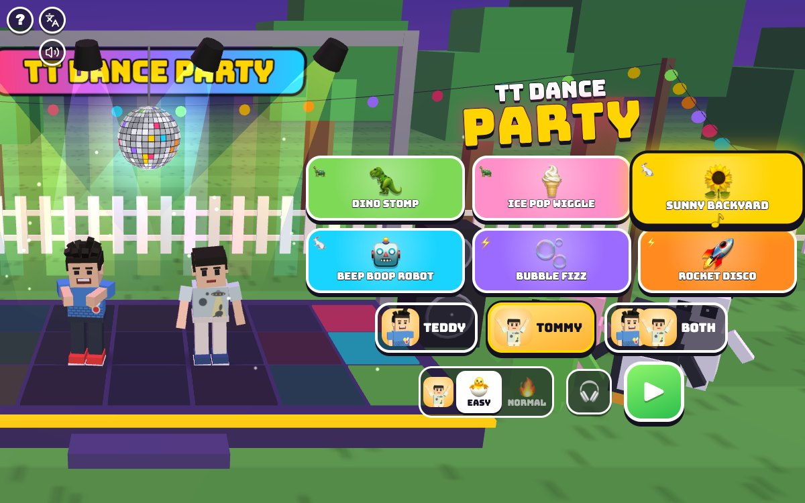

# TT Dance Party

[](https://adong.github.io/dance-party-tt/)

Press **?** any time (or tap the round **?** button in the top left corner) to see the keys. The game waits while you look.
Tap the language button under it (the A文 icon) to switch between English and 中文; the dashboard and every game remember the choice.

**中文：** 跳舞游戏：在后院的迪斯科舞台上，跟着六首原创歌曲，箭头落下来就按键，Teddy 和 Tommy 就会跳出拳击、投篮、比耶、机器人舞和转圈，动物朋友们在旁边欢呼。

A rhythm dance game starring Teddy and Tommy, on a disco stage in the backyard at sunset: string lights, swinging spotlights, a disco ball, a light-up floor and a crowd of animal friends (a bunny, a bear, a duck, a cat, a frog, a pig, a penguin and a panda) who bounce on the beat and cheer when the combo grows. Arrows fall down the lanes onto big pads at the bottom; hit each one as it lands, on the beat, and your dancer does a move. Six songs of our own, two levels, one dancer or both brothers side by side in a friendly dance battle, and your brother is always one tap away.

It's built with Claude Code from plain JavaScript and Three.js, in the same style as Metro Surfer and the other Teddy & Tommy games. There are no image, model or audio files: the stage is boxes and canvas textures, the characters and their poses come from the shared kit (`kit/`), and every note of the music is synthesised.

The name lives in one place, [js/title.js](js/title.js). "TT Dance Party" is a working title until Alan names it.

## Play

- **Double-click `index.html`.** It works offline, because Three.js and the kit are copied into `kit/`. Without internet the logo falls back from the Bungee font to Arial Black.
- **Send one file:** `dist/dance-party-tt.html` is the whole game in one file. AirDrop or email it, then open it in a browser.
- **Rebuild that file** after any edit: `python3 kit/tools/bundle.py . --name dance-party-tt`
- **Get kit updates** from `~/claude-games/kit`: `python3 ../kit/tools/sync.py .`, then rebuild.
- **On the home screen** tap a song (it starts playing quietly, so you can hear it first), pick who dances (TEDDY, TOMMY or BOTH), pick 🐣 EASY or 🔥 NORMAL for each dancer, then ▶. Tapping the song that's already picked starts it too.
- **Each song** starts with the song's name and READY?, then a count-in bar: 3, 2, 1, DANCE! on four clicks. Songs are about a minute long.
- **The end:** up to 3 stars, the score, NEW BEST! when you beat your best, and how many PERFECT, GREAT, OK and OOPS. The winner does his signature move (Teddy's boxing combo or his 🏀 jump shot, taking turns; Tommy's Y with peace fingers ✌️) while confetti flies and the crowd cheers. 🔁 dances the song again, ⏭️ goes to the next song, 🏠 back to the songs.
- **Saved per browser:** the song, who dances, each brother's level, the timing setting, and the best score and stars for every song at each level. `index.html` and `dist/dance-party-tt.html` each keep their own, because they're different ways of opening the game.

### EASY and NORMAL

| | 🐣 EASY (Tommy, 5) | 🔥 NORMAL (Teddy, 8) |
|---|---|---|
| lanes | 2 big lanes: ← and → | 4 lanes: ← ↓ ↑ → |
| notes | only on the beats, never two at once | eighth notes, a few ← → jumps, hold notes |
| scrolling | slow: an arrow takes 2.4 s to fall | 1.7 s |
| timing window | PERFECT ±75 ms, GREAT ±140 ms, OK ±210 ms | ±45, ±90, ±135 ms |
| a miss | a cute stumble, and the combo starts again | the same, and the dance meter drops |
| the song ends early | never | if the dance meter runs out ("TIRED OUT!") |
| stars | at least 1 for dancing to the end | 0 to 3 |

- **Stars** come from how well you danced: points against a perfect run (PERFECT 300, GREAT 200, OK 100, 100 more for each hold kept to its end). 40 % is one star, 70 % two, 90 % three.
- **Score** adds a combo bonus on top, up to double at a 40 combo, so long combos score big.
- **The dance meter** (NORMAL) starts at 60 %; every hit fills it a little (PERFECT 3 %, GREAT 2.5 %, OK 1.5 %), every miss takes 7 %, and a treat from your brother gives 25 %. Missing the first nine notes in a row empties it.
- **Hold notes** have a ribbon behind the arrow: keep the key or pad down until the ribbon ends (letting go up to 0.12 s early still counts). Your dancer holds his pose while you hold.
- **2 players:** each brother has his own level, so Teddy can dance NORMAL while Tommy dances EASY to the same song. The winner is whoever got more stars, then the higher percentage (so EASY and NORMAL are fair against each other); within half a percent it's 🤝 BOTH WIN!

### The dance moves

Every hit makes your dancer do a move, built from the kit's poses (`Kit.people.pose`, read off so they stay the kit's):

- **NORMAL:** ← is a slide to the left (Teddy: a boxing jab), ↑ is Teddy's 🏀 jump shot or Tommy's Y with peace fingers, → is an arm wave (Teddy: a boxing straight), ↓ is a squat-hop or a stiff robot, in turns.
- **EASY:** each hit is the next move in the dancer's own list, toward the arrow's side: Tommy goes Y pose, wave, hop, slide, robot, clap; Teddy goes jab, jump shot, robot, slide, hop, wave.
- **Every 10 in a row:** a spin. **A miss:** a wobbly stumble with flailing arms (he never falls).
- Between hits the dancers groove on the beat: knees dip on every beat, Teddy keeps his fists up like a boxer, Tommy sways.

### Timing (Bluetooth speakers)

The 🎧 button on the home screen (or **C**) opens the timing screen. Listen to the drum and tap the big drum pad (or Space, or any arrow) on every boom: a count-in bar, then 16 booms. The game takes the middle value of how late your taps were (stray taps are ignored), and from then on shifts the falling arrows and the judging by that much, so the arrows land when you *hear* the beat. − and + nudge it by 10 ms; the ring around the drum flashes on the beat with the setting applied, so you can check it. It's saved. Bluetooth speakers are often 150 to 250 ms late.

## Songs

All six are our own, composed in code in [js/songs.js](js/songs.js): chords per bar, drum, bass and chord patterns in sixteenth notes, and a melody written in scale degrees. Each has an intro (a count-in bar, then the groove), verses, a chorus and an ending with a final hit and cymbal. Nobody has listened to them yet (see Not verified).

| | Song | Tempo | Key | Mood | Length | 🐣 notes | 🔥 notes (holds) |
|---|---|---|---|---|---|---|---|
| 🦖 | Dino Stomp | 90 BPM | E minor | big and stompy: heavy kicks, a low saw-bass riff, tom fills | 63 s | 51 | 78 (4) |
| 🍦 | Ice Pop Wiggle | 96 BPM | F major | a wiggly toy-box tune: bell melody, wood-block clicks, round bass | 59 s | 55 | 81 (4) |
| 🌻 | Sunny Backyard | 104 BPM | C major | the theme song: sunny and a little funky, chip-tune lead, chords on the off-beats | 64 s | 66 | 94 (9) |
| 🤖 | Beep Boop Robot | 116 BPM | A minor | beepy and stiff: square bass bouncing in octaves, bleeps, a sixteenth-note arpeggio | 66 s | 69 | 110 (8) |
| 🫧 | Bubble Fizz | 126 BPM | G major | sparkly pop: plucky lead, a popping-bubbles arpeggio, claps and shakers | 60 s | 68 | 102 (10) |
| 🚀 | Rocket Disco | 138 BPM | D minor | the fast one: four-on-the-floor disco, octave bass, open hats | 62 s | 86 | 124 (12) |

The cards show 🐢 (up to 100 BPM), 🐇 (up to 120) or ⚡ for the speed, and your best stars at each level.

- **Charts** ([js/charts.js](js/charts.js)) are built on each song's beat grid: every bar has 8 slots, one per eighth note, and the patterns that fill them are hand-tuned per section and level ('a' falls back to 'A'). They set the rhythm: EASY only uses the beats; NORMAL mixes quarter and eighth notes, adds jumps on the big moments and holds over long melody notes.
- **The arrows are shuffled every time you dance** (and differently for each brother), so the same song never plays the same way twice. The rules keep it playable: a lane is only used again when it's far enough from its last note, a thumb that's holding a note gets nothing else until just after the hold ends, and a jump is one arrow for each thumb. On NORMAL the next arrow is never the same as the last one, and usually not the one before either. On EASY it's left or right at random, but never more than 3 on one side in a row.
- **The music** plays through `Kit.sound.tone` / `Kit.sound.hiss`, so the kit's sound switch mutes it. Songs are scheduled 0.2 s ahead on the AudioContext clock. The kit doesn't hand out its AudioContext, so [js/audio.js](js/audio.js) wraps the AudioContext constructor before the kit makes one (on the first tap or key) and keeps a reference; nothing else about the kit's sound changes.
- **The song clock** ([js/clock.js](js/clock.js)) follows the AudioContext clock while the sound runs, so the arrows and the music can't drift apart, and carries on from `performance.now()` when the sound is suspended (before the first tap, while the browser has the audio asleep). When the audio comes back it picks it up again without a jump. Pausing stops both, and the ? panel freezes both.

## Controls

| Teddy (left, or anyone alone) | Tommy (right, or anyone alone) | Touch | |
|---|---|---|---|
| `A` `S` `W` `D` | `←` `↓` `↑` `→` | the four pads | dance on 🔥 NORMAL (← ↓ ↑ →) |
| `A` `D` | `←` `→` | the two big pads | dance on 🐣 EASY |
| hold the key | hold the key | keep your thumb down | hold notes |
| `T` | `Enter` | your brother's face | call your brother |
| `P` / `Esc` | | ⏸️ button | pause (▶ keep dancing, 🔁 start the song again, 🏠 songs) |
| `M` | | 🔊 button | sound on / off |

On the home screen: `←` `→` (or `A` `D`) pick a song, `↑` `↓` the level (with both dancing, `W` `S` is Teddy's and `↑` `↓` Tommy's), `1` `2` `3` who dances (Teddy, Tommy, both), `C` the timing screen, `Enter` or `Space` to dance. On the results, `Enter` dances again, `N` the next song, `Esc` home.

- **The pads** sit at the bottom right under their lanes, big enough for thumbs: on a phone held sideways they're 61 px tall, on an iPad 124 px. With one dancer the lanes split in two, left thumb and right thumb (← ↓ on the left, ↑ → on the right), and the dancer is in the middle. With two, Teddy's lanes are on the left and Tommy's on the right. A pad lights up while it's down; hold notes count a pad held down.
- **The kit's buttons** (? and A文, and the speaker on menus) sit in the top left corner in this game, well away from the pads.

## Companion

Call your brother any time in a song, as often as you like: **T** (or Enter with one dancer), or tap his face (the big round button between the pads; with two dancers, the face next to your score). The brother comes from `Kit.roster.buddyFor`: Tommy when Teddy dances, Teddy when Tommy dances.

- **He jumps up on stage** beside you at his buddy size (`buddyScale`, with a name tag) and says hello with his signature move: Teddy's boxing combo, Tommy's Y with peace fingers.
- **He tosses a treat** (🍦 💧 🧃 🍪 🍉 🍌) that flies into your hand: "🍪 COOKIE FROM TOMMY!". On NORMAL it fills the dance meter by 25 %.
- **For 8 seconds he dances along,** copying your moves, and says "TOMMY SAYS: FOLLOW ME!": the timing window is twice as wide and the coming arrows glow gold. His button glows while he's there.
- Then he says bye (Teddy: his 🏀 jump shot) and hops off. Calling again while he's there says hello again, brings another treat and starts the 8 seconds again.
- **With two dancers** your brother is already dancing next to you, so he does his signature move from his spot and tosses the treat across; the help is the same.

## How it was checked

Nobody listened (Alan works next to the sessions), so the game was tested muted and the sync was proved in code.

**Headless, in Node:** `node tools/check.js` runs the page's own songs, charts, clock and judging ([js/checks.js](js/checks.js)) without a browser, in under a second. In the page the same checks run as `game.check()`. All pass:

- **grid:** every note and hold tail of all 12 charts sits on its song's eighth-note grid to within 1 ms (worked out again from the tempo), a drum or note of the music sounds at that moment, and nothing is in the count-in bar or after the final hit.
- **playable:** no impossible notes: the same lane is at least 0.4 s apart on EASY and 0.2 s on NORMAL (after a hold's tail), nothing needs one thumb twice at once or while it's holding, and the first arrows can scroll in from the top.
- **easyLanes:** EASY charts use exactly the 2 lanes; NORMAL uses all 4.
- **variety:** the shuffled arrows are well mixed, never "all ← so far": the first 6 arrows use both sides (EASY) or 3 different arrows (NORMAL), at most 3 in a row on one side (EASY) or 2 on one arrow (NORMAL), any 8 arrows in a row on NORMAL use at least 3 of the 4, and no arrow has more than 70 % (EASY) or 45 % (NORMAL) of a song.
- grid, playable, easyLanes and variety run on 50 shuffles of every chart (plus the patterns' own arrows), and perfect on 4 shuffles, because a new shuffle is dealt every time.
- **perfect:** an autopilot pressing every note at its exact time gets every PERFECT, every hold and 3 stars, on every song at both levels; so does one pressing on 60 fps frames.
- **allMiss:** an autopilot that never presses never ends a song on EASY. (On NORMAL its meter runs out after 9 misses, as it should.)
- **fallback:** with fake clocks, the song clock follows the audio clock, keeps time from `performance.now()` while the audio is suspended (2 s to the millisecond), picks the audio clock up again without a jump, stands still while paused and while the ? panel is open, keeps the music's anchor through a pause, and never runs backwards.
- **calibration:** taps 120 ms late with wobble, a double tap and a stray tap give 120 ms; on time gives 0; two taps are not enough.
- **The checks can fail:** `game.check()` (and the Node run) also breaks each check on purpose and confirms it then fails: a note 5 ms off the grid, two notes under one thumb, a third lane on EASY, a chart that's all ←, an autopilot 60 ms late, an EASY that can end, a clock with no fallback, an average instead of a median.

**In the Browser pane** (time driven by `game.step()`, because the hidden pane throttles `requestAnimationFrame`):

```js
localStorage.setItem('claudeGames.muted', '1')   // always, before anything plays; then reload
game.hold(true)                                  // only game.step() moves time (on a stand-in clock)
game.start('robot', { who: 'both', levels: { teddy: 'normal', tommy: 'easy' }, seed: 42 })   // seed: the arrow shuffle (optional)
game.autopilot('perfect')                        // or 'miss', or null to hand it back
game.step(10)                                    // advance 10 s at 60 fps, drawing as it goes
game.buddy(0); game.pause(true); game.pause(false)
game.press(lane, player); game.release(lane, player)
game.timing(); game.calTap(); game.setOffset(0.15)
game.check()                                     // the headless checks, with their proofs
game.info()                                      // state, song time, clock mode, audio state, every dancer's score
```

- **Real audio, muted:** with the sound switched off (the kit's master gain at 0) and the AudioContext running, the song clock ran on the audio clock (song time and AudioContext time agreed to the millisecond), and all 86 sound times scheduled over several seconds were exact song events (worst error 0.0002 ms). With the ? panel open the clock moved 0 ms and nothing was scheduled; after it closed the music's anchor was the same. The same for P / ⏸️ pause.
- **Flows:** every song played to the end by the autopilot at both levels, 1 and 2 dancers (all PERFECT, every hold, 3 stars, 🤝 BOTH WIN!); an all-miss NORMAL run ending in TIRED OUT!; the buddy in 1 and 2 players with the treat toast and the glowing notes; keys, pads (pointer events), T, P and Esc; the timing screen with taps 120 ms late (it set 128 to 134 ms, within one 60 fps frame).
- **Screens:** desktop, iPad landscape (1024 x 768) and portrait (820 x 1180), phone portrait (390 x 844) and landscape (740 x 360). No pad ever sits under the kit's buttons. Smallest pad: 56 px on phones, 77 px on iPad landscape with two NORMAL dancers; the one tight case is two NORMAL dancers on a phone held upright (42 px wide pads).
- **中文:** with `Kit.lang.set('zh')`, the home screen, the song intro, dancing, misses, the buddy, pause, both kinds of results, 2 players, the timing screen and the ? panel: `Kit.lang.untranslated()` is `[]` everywhere, and a made-up English line shows up in it (so it can fail). What's left in English is names (the game, the songs, Teddy and Tommy) and key labels. In English mode nothing on the page or on the canvas is Chinese except the kit's language button tooltip, which names the language a tap switches to.
- No console errors.

## Files

```
index.html          page, menus, HUD, pads and overlays (CSS inline)
js/title.js         the game's name, in one place
js/songs.js         the six songs as data, compiled to timed sound events (no Three.js, runs in Node)
js/charts.js        the hand-tuned rhythms on each song's beat grid, EASY and NORMAL, and the arrow shuffle (runs in Node)
js/clock.js         the song clock (audio clock with a performance.now() fallback) and the timing maths (runs in Node)
js/engine.js        judging, score, combo, stars, the dance meter, holds (runs in Node)
js/checks.js        the headless checks and their proofs (game.check() and tools/check.js)
js/audio.js         the instruments, the look-ahead song player on the AudioContext clock, the effects
js/stage.js         Three.js: the backyard, the stage, lights, disco ball, speakers, the animal crowd, the camera
js/dancer.js        the dancers: the groove, every dance move from the kit's poses, the stumble, signatures
js/highway.js       the lanes, falling arrows, hold ribbons, pop-ups, combo, sparkles and confetti (2D canvas)
js/buddy.js         calling your brother: the jump on stage, signature move, treat, 8 s dance-along
js/game.js          home, the song loop, input, pads, layout, pause, results, the timing screen, window.game
js/keys.js          the keys the ? panel shows (Kit.help)
js/zh.js            中文 (Kit.lang); names and the game's name stay English
tools/check.js      the headless checks in Node
kit/                copy of ~/claude-games/kit; edit the kit there, not here
dist/dance-party-tt.html  the single-file build
```

## Kit candidates

These live in this game for now:

- A way to get the kit's AudioContext time (`Kit.sound.now()` or `Kit.sound.ctx`), so a game can schedule on the audio clock without wrapping the constructor as [js/audio.js](js/audio.js) does.
- The song compiler in [js/songs.js](js/songs.js): chords, drum / bass / chord patterns and a melody in scale degrees, turned into `tone` / `hiss` events, for any game that wants its own music instead of the kit's loop.
- The extra dance moves in [js/dancer.js](js/dancer.js) (slide, robot, wave, hop, clap, spin, stumble, cheer, tired) and the probe that reads the kit's own poses as numbers.

## Not verified

- **The music:** nobody has listened to the songs yet. They are scheduled and timed correctly (checked in code, above), but whether the melodies and the mix sound good, and whether every instrument is loud enough, is untested. The same goes for the sound effects.
- **Bluetooth latency:** the timing screen is built for it and its maths is checked, but it hasn't been tried with real Bluetooth speakers or real taps.
- **Real touch devices:** the pads use pointer events, tested with scripted events and in phone and iPad emulation, not with thumbs on a real iPad or phone or in iOS Safari (multi-touch for holds while tapping another pad is untested).
- **Frame rate on an iPad:** not timed on a device.
- **How hard it is for real kids:** the charts were tuned by reading them, not by watching Teddy and Tommy play.
- **file://:** the page uses only classic `<script src>` tags and no fetches; the single-file build was opened from `file://` in headless Chrome for the screenshot.
